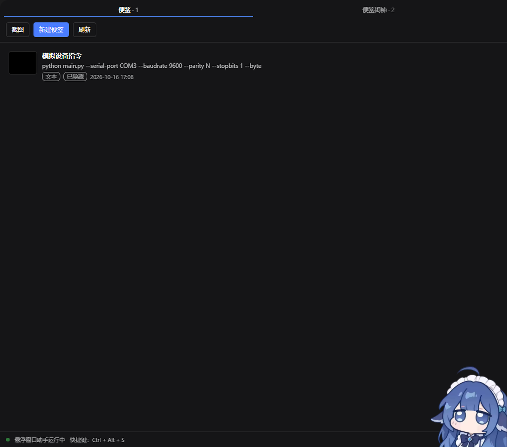
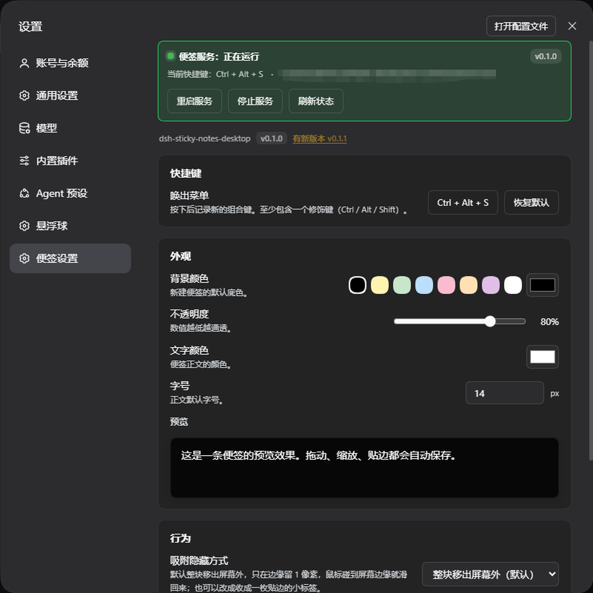
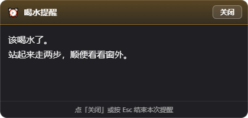
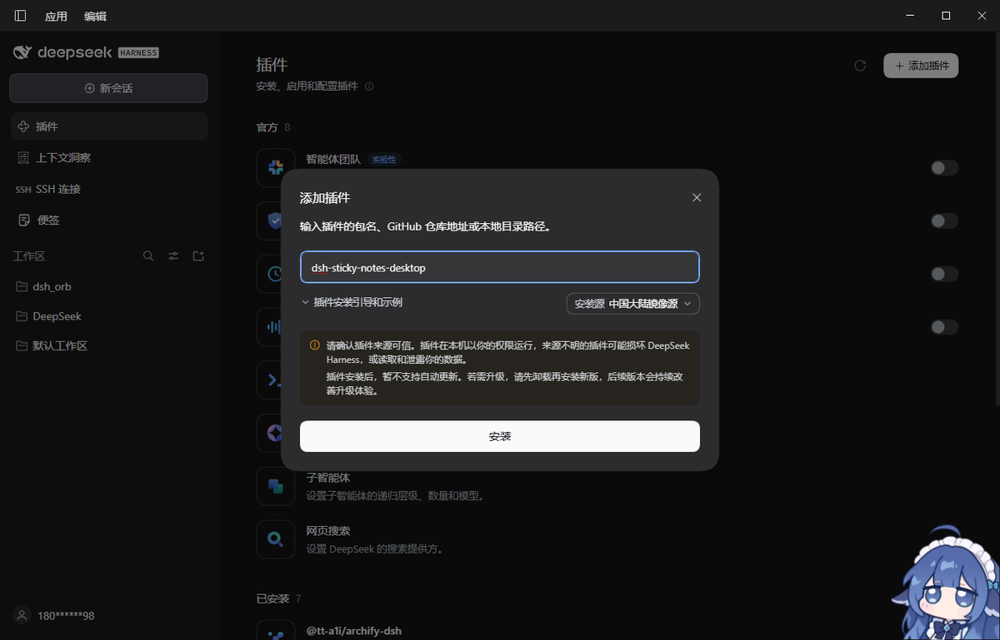
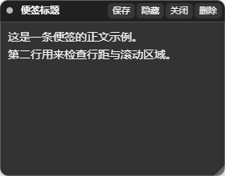

# dsh-sticky-notes-desktop

**中文** | [English](README.md)

给 **DeepSeek Harness** 用的桌面便签与截图标注插件。便签是**真实的、系统级置顶窗口** —— 切到别的软件、把 DSH 最小化，都盖不住它。

- **快捷键便签** —— 快捷键在鼠标处弹出「新建便签 / 截图」菜单。便签可自由拖动缩放，贴到屏幕边缘会自动吸附并收起来。
- **关掉还在** —— 位置与隐藏状态会随手保存，关掉 DSH 再打开，所有便签（包括已隐藏的）都回到原位。
- **便签闹钟** —— 让一条便签到点自动弹到最前面：每天、工作日，或指定某一次。
- **也能在对话里要** —— `sticky_notes_*` 工具让模型新建、查看、移动、隐藏、删除便签，以及设置闹钟。

---

## 界面

左侧栏入口显示为 **便签**；面板两个标签：**便签** / **便签闹钟**：



「设置 → **便签设置**」是独立一页 —— 快捷键录制、颜色、不透明度、字号、吸附与隐藏行为、服务状态、当前版本与是否有新版本，带实时预览：



## 便签闹钟

「到某个时间，把这条内容弹到我眼前。」把面板切到 **便签闹钟** 标签即可管理。



| 项 | 说明 |
|---|---|
| 内容 | **文字**或**图片**（图片用系统文件选择框挑：png/jpg/gif/webp/bmp） |
| 每天 | 每天的 `HH:MM` |
| 工作日 | 周一至周五的 `HH:MM` |
| 指定时间 | 某年某月某日某时某分，**只响一次** |
| 列表按钮 | 试响 / 编辑 / 启用停用 / 删除；正在响时多一个「关闭响铃」 |
| **弹出位置** | 默认在**屏幕正中央**；点「试响」，把弹出的窗口拖到你要的位置，位置会被记住 |

**行为**

- 平时不占屏幕，到点才弹出一个**置顶窗口**，内容就是设定的文字或图片；
- 点「关闭」、按 `Esc`、或右键窗口即结束本次提醒；
- 一个闹钟一个窗口 —— 两条同时响时，关掉一条不会连带关掉另一条；
- **错过了也会补响**：到点时 DSH 没开着，下次启动会立刻响一次。闹钟宁可迟到，也不能静默消失；
- 同一分钟内只响一次，不会因为轮询而连响几十遍；
- 弹窗是**瞬时**的，不会被"恢复"：关掉就是关掉了。

### 用「试响」调整弹出位置

**试响就是位置调节器：**

1. 在编辑器里点 **试响**（**新建时也能点**，不必先保存）；
2. 把弹出的窗口**直接拖**到你要的位置；
3. 关掉它 —— 编辑器里的「位置」立刻变成你刚拖到的坐标；
4. 保存。以后这条闹钟就弹在那里。

点「恢复默认位置」回到屏幕正中央。

> 「试响」不会消耗闹钟：它不写 `lastFiredAt`，所以指定时间型闹钟试听之后**仍然会在设定时刻响**；新建时的试响也**不会产生任何存储记录**。
>
> 保存的位置如果落在已经不存在的屏幕上（拔了外接显示器、改了分辨率），弹出时会被拉回可见范围 —— 否则闹钟会出现在看不见的地方，就没法关掉它了。

## 安装

**最省事的方式 —— 用 DSH 自带的插件管理。** 打开「插件」，点「添加插件」，填入包名，点「安装」：



```
dsh-sticky-notes-desktop
```

就这一步，不用克隆仓库也不用开终端。这个输入框接受 npm 包名、GitHub 仓库地址，或本地目录路径。

> 建议先看一眼提示上方的**「安装源」**下拉框：它默认选中**中国大陆镜像源**，在国内是对的，在外面是错的。
> 如果你不在国内、安装很慢或失败，把它切换成默认源。

然后**重启 DSH**：profile 的 bundle 列表只在启动时读取。

下面这几种是从对话侧做同样的事，不想用界面时用。

**从 npm 安装**

```
plugin_manager(action="install_bundle", target="dsh-sticky-notes-desktop")
```

包名就是 [`dsh-sticky-notes-desktop`](https://www.npmjs.com/package/dsh-sticky-notes-desktop)，这是最省事的方式：不用克隆仓库，也不用自己打包。

**从本仓库安装**

```
plugin_manager(action="install_bundle", target="<这个检出目录的绝对路径>")
```

路径**必须是绝对路径**（相对路径会被拒绝）。本地目录以 `link:` 形式记录，也就是软链接到源码目录，改完代码重启 DSH 就是新代码 —— 开发时很方便。

**从打包文件安装**

```bash
npm pack    # 产出 dsh-sticky-notes-desktop-<版本号>.tgz
```

```
plugin_manager(action="install_bundle", target="<那个 .tgz 的绝对路径>")
```

`.tgz` 会被真正**复制**进 profile，不再指向源码目录，所以在别的机器上也能用。

> `~/.dsh/profiles/desktop` 由 Electron 应用独占管理，`dsh --profile desktop` 会被拒绝。请通过应用内的插件管理安装，或直接改该 profile 的 `package.json`。

### 关于安装的几点说明

| | |
|---|---|
| 唯一必需的清单字段 | `dsh.bundle.patch` —— DSH 判定"这是不是一个 bundle"只看这一个字段 |
| `target` 支持的形式 | 绝对目录、绝对 `.tgz`（本地或 http）、git 地址、npm 包名。**相对路径会被拒绝。** |
| 浏览器半必须预先构建好 | DSH 不在安装时构建。`npm pack` 会自动跑一次 `prepack` 检查，确保打包进去的 bundle 是最新的。 |
| `files` 只对 `.tgz`/npm 安装有意义 | `link:` 安装是软链接到源码目录，所以缺文件只会在**别人**那里炸。测试里有一条专门守着它。 |

## 首次使用

默认快捷键 **Ctrl + Alt + S** 会在鼠标位置弹出菜单，选「新建便签」或「截图」。

默认便签是**黑底、80% 不透明度、浅色文字**（`#000000` / `0.8` / `#f5f5f5`）：



颜色、透明度、文字色都在「设置 → 便签设置」里改。

**文字色**只管便签自己的内容 —— 标题和正文。标题栏上的控件**刻意不跟随**文字色：按钮、类型标记、
分割线、输入提示都从便签**背景色**推出自己的颜色，所以不管你选什么文字色，它们都看得清。在黑便签上
选深色文字，正文难读是你自己的选择，但「保存」「关闭」依然清晰。

---

## 快捷键

| 场景 | 按键 |
|---|---|
| 唤出菜单 | 默认 `Ctrl+Alt+S`，可在设置里改成任意组合 |
| 截图：确认选区 / 保存图片 | `Enter` |
| 截图：存为便签 | `Ctrl+Enter` |
| 截图：复制到剪贴板 | `Ctrl+C` |
| 截图：撤销 / 重做 | `Ctrl+Z` / `Ctrl+Shift+Z` |
| 截图：全屏选区 / 取消 | `Ctrl+A` / `Esc` |
| 便签：保存草稿 | `Ctrl+S` |

快捷键是**系统级**的（Electron `globalShortcut`），DSH 不在前台也能触发。

### 快捷键被占用时会明确报出来，不会偷偷换键

默认就是 **`Ctrl+Alt+S`**，注册的也**永远只是你设置的那个组合**。自动换成别的键会让你按对了键却没反应，所以插件选择把冲突明确报出来，由你决定换哪个。

冲突时你能在三处看到：**「设置 → 便签设置」顶部红色横幅**（写明是哪个组合被占）、**便签面板底部脚注变红**、以及录制新组合时立刻弹出的红色提示。

`Ctrl+Alt+S` 是个很抢手的组合 —— Windows 11 的「截图工具」和若干录屏软件都会占用它。`Ctrl+Shift+S`、`Ctrl+Shift+Alt+S`、`Ctrl+Alt+Shift+N` 通常是空的。

## 快捷键新建的便签是「草稿」

按快捷键新建的便签**只有点过「保存」才会进入便签列表**：

- 标题栏会显示一枚 **`未保存`** 标记，直到你保存；
- 期间输入的内容只存在于那个窗口里，**不会写进 `data.json`**；
- **直接关闭（或删掉）→ 什么都不会留下**，列表里不会多出一条；
- 点「保存」（或按 `Ctrl+S`）→ 立即出现在左侧便签列表，之后编辑都会自动保存。

> 「关闭」对两种便签含义不同：**已保存**的便签点「关闭」只是收起窗口，内容还在列表里；**草稿**点「关闭」就是丢弃。
>
> 从左侧列表点「新建便签」走的是另一条路 —— 由 host 直接创建，**立刻就在列表里**，没有草稿阶段。

## 屏幕边缘吸附 / 自动隐藏

- 拖动便签，距离屏幕边缘 12px 以内自动吸附（距离可调）。
- 吸附后短暂停顿即自动隐藏。**默认是整块移出屏幕外**，只在边缘留 1px。
- 鼠标推到那条屏幕边缘（默认 120ms 后）便签滑回完整尺寸；鼠标移开后又会在延迟后重新隐藏。
- 隐藏时窗口是**点击穿透**的，不会挡住它下面的窗口。

> 留 1px 而不是 0 是刻意的：完全移出屏幕后，那块便签只能靠"把指针移到某个什么都没有的位置"才能唤回。1px 肉眼不可见，但让边缘可命中。

### 「保留」

便签标题栏上有一个 **`保留`** 按钮：

- 点一下 → 变成 **`取消保留`**（并高亮），这条便签从此**不再吸附、也不会自动隐藏**，就停在你放的位置；
- 再点一下 → 交还给正常行为。

保留的便签还可以**往左、右、下三个方向挂出屏幕** —— 「就停在这儿」这个要求，只有在便签能挂在屏幕边上
时才算真的成立：一半挂在右边缘外，既让开了地方，又还看得见。

- **屏内至少留 40px**，所以任何时候都抓得回来。
- **上边是例外**，始终贴齐屏幕顶边：标题栏是唯一能拖动便签的地方，往上挂出等于把它自己的把手推出
  屏幕，那条便签就再也拖不动了。

这个状态存在 `data.json` 里，重启后依然生效。左侧栏列表里也有同样的按钮。

## 截图与标注

框选任意区域后可以画矩形框、椭圆框、箭头，用自由画笔，输入文字；8 色色板、3 档线宽、撤销 / 重做 / 清空。三个出口：

| 按钮 | 行为 |
|---|---|
| **保存图片** | 弹出系统**保存对话框**，自己选位置和文件名；取消则留在标注界面，不会丢 |
| **存为便签** | 变成一张**置顶悬浮**的截图便签，**生成在你框选的那块屏幕位置上**，和手动新建的便签完全一样 |
| **复制** | 写进系统剪贴板 |

导出的是**干净的选区图** —— 遮罩、工具条、尺寸标签都不会混进去。

## 数据

| 路径 | 内容 |
|---|---|
| `~/.dsh/sticky-notes/data.json` | 便签索引 + 闹钟 + 设置 |
| `~/.dsh/sticky-notes/shots/<id>.png` | 截图便签的像素 |
| `~/.dsh/sticky-notes/shot-notes/shot-*.png` | 「存为便签」生成的截图 |
| `~/.dsh/sticky-notes/helper.lock` | 助手持有者 pid |
| `~/.dsh/sticky-notes/electron-runtime/` | 自备的 Electron 运行时（如果有） |

索引是**原子写**（临时文件 + rename）；文件损坏时会被改名隔离并重建，不会让插件起不来。

## 便签服务状态（设置 → 便签设置）

设置页最上方是一条**便签服务**状态，回答"现在到底能不能弹窗"：

| 显示 | 含义 |
|---|---|
| 🟢 **正在运行** | 进程在**并且真的应答了** —— 还会显示显示器数量、当前生效快捷键、PID、Electron 路径 |
| 🟡 **无响应** | 进程还在但不再应答 —— 通常发生在换插件版本之后旧进程还留着。**点「重启服务」** |
| 🔴 **未运行** | 没在跑，或启动失败（会把原因写出来） |

按钮：**启动服务** / **重启服务** / **停止服务** / **刷新状态**。

> 状态不是"宿主记着它启动过"，而是**真的问它一句**。这两者在出问题的时候正好不一样：一个卡住的助手仍然会让宿主以为一切正常，而「重启服务」存在的意义就是修它 —— 所以那种情况必须显示成**无响应**，而不是**正在运行**。

## 设置项

| 项 | 说明 |
|---|---|
| 快捷键 | 点一下再按组合键即可录制；至少需要一个修饰键 |
| 背景颜色 / 文字颜色 | 8 色预设 + 取色器 |
| 不透明度 | 20%–100%，带实时预览 |
| 字号 | 8–72px |
| **吸附隐藏方式** | **整块移出屏幕外（默认）/ 边缘小标签** |
| 吸附距离 | 离边缘多少像素内吸附 |
| 自动隐藏延迟 | 贴边后停多久隐藏 |
| 唤出延迟 | 鼠标碰到屏幕边缘后多久滑回 |
| 随 DSH 自动启动 | 关掉后助手不再自动拉起 |

页面下方还会显示**当前安装的版本号**，并告诉你 npm 上有没有更新的版本：**有新版本 vX.Y.Z**（点一下可
重新检查）或**已是最新**。如果这个包不是从 registry 装的（本地目录或 `.tgz`），就什么都不显示 ——
没有可比的已发布版本；检查失败时同样不显示，离线不该被弹一句错。

> 便签窗口**自身不带取色按钮**：颜色属于偏好设置，统一在「便签设置」里改。标题栏只有 保存 / 保留 / 关闭 / 删除（截图便签多一个「另存」）。

## 给模型用的文档

这个插件给模型一套有文档的工具面，而不是让它自己猜。12 个工具，一个操作一个：

`sticky_notes_list` · `sticky_notes_create` · `sticky_notes_read` · `sticky_notes_update` ·
`sticky_notes_delete` · `sticky_notes_show` · `sticky_notes_hide` ·
`sticky_notes_alarm_list` · `sticky_notes_alarm_set` · `sticky_notes_alarm_delete` ·
`sticky_notes_alarm_ring` · `sticky_notes_screenshot`

此外还有一段**系统提示**（始终在场，作用是让模型在用户说"记一下"时不要伸手去拿 shell）和一个名为 **`sticky-notes` 的技能**，承载更长的工作流说明。

## 排障

**按了快捷键没反应。** 按可能性排序：

1. **DSH 没有重启过。** host 半和助手都只在启动时加载，在那之前助手会一直跑着旧代码。
2. **组合被别的软件占用了。** 去「设置 → 便签设置」看顶部红色横幅；便签面板底部的脚注也会变红。在「唤出菜单」里重新录制一个。
3. **助手没起来。** 「便签设置」页的横幅会写明原因：
   - *未找到 Electron 运行时* → 首次使用需要下载约 120MB；确认网络，或设置 `DSH_STICKY_NOTES_ELECTRON` 指向一个已有的 Electron 可执行文件。
   - *另一个便签助手正在使用同一数据目录* → 有另一个 DSH 实例开着；先关掉它。

**弹窗点了外面不消失。** 点菜单项、按 `Esc`、或把鼠标移开都会让它消失 —— "点在外面"之所以有效，是因为弹窗先让开，点击落到了你真正想点的窗口上。

**便签窗口弹不出来。** 同上第 3 条；另外确认「随 DSH 自动启动」没有被关掉。

**模型完全不理这个插件，什么都用 shell 凑。** 说明它看不到工具，也就是插件没注册上 —— 确认这次会话的工具列表里有没有 `sticky_notes_*`，然后重启 DSH。

**降级行为。** 助手起不来时，插件不会崩、DSH 也不会崩：便签列表、编辑、删除、设置全部照常可用，只是暂时无法弹出置顶窗口。

## 已知限制

- **同一时间只能有一个 DSH 实例用它**：助手按数据目录加锁，第二个实例会明确报错，而不是重复弹窗。
- **截图只覆盖鼠标所在的显示器**：多屏时先把指针放到目标屏幕上。
- **`hiddenRevealWidth` 已废弃**：小标签厚度固定 36px，受平台最小窗口宽度约束。

## 许可

MIT
